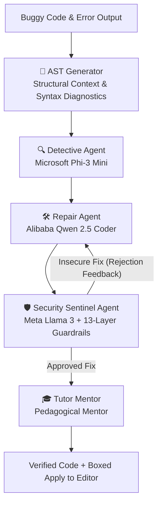

# Collaborative Multi-Agent Sandbox Compiler & Debugger Platform

A production-grade Automated Program Repair (APR) and cloud compiler platform styled after CodeChef, Codeforces, and Programiz. Features isolated Docker sandboxing, high-precision Green Sandbox Metrics (energy & carbon tracking), multi-tab file management with PC folder access, Abstract Syntax Tree (AST) visualization, and collaborative Multi-Agent intelligence powered by **Microsoft Phi-3**, **Alibaba Qwen**, and **Meta Llama 3** via Ollama.

---

## 🌟 Key Capabilities

### 💻 Multi-Tab Monaco Editor & PC Folder Integration
* **Multi-Tab File System:** Create new tabs (`+`), close tabs (`×`), switch between multiple source files (`solution.cpp`, `helper.h`, `script.py`, `Main.java`), and inline rename tabs by double-clicking.
* **Open File & Folder from PC:** Direct PC access to open local source files or load entire folders with a built-in collapsible Folder Explorer sidebar.
* **Monaco Editor Core:** Full VS Code editor engine with syntax highlighting, auto-completion, font scaling (11px–24px), minimap toggle, and keyboard shortcuts (`Ctrl+Enter` to run).
* **Light & Dark Theme Switch:** One-click toggle between sleek dark mode (`#0b0f17`) and crisp white background light mode (`#ffffff`) across all panels and Monaco.
* **Boxed "Apply to Editor":** Prominent boxed action buttons on AI code blocks to inject verified patches directly into the active editor tab.

### ⚡ Multi-Language Sandboxed Execution
* **Zero-Trust Docker Sandboxing:** Non-root isolated execution for **Python**, **C++**, and **Java** with hard memory caps (256MB), network isolation (`--network none`), timeout kill-switches, and clean container lifecycle cleanup.
* **Native Host Clang++ Fallback:** Seamless local Windows compilation via Clang++ with MinGW GNU C++ headers when Docker daemon is not active.
* **Full Standard Input (`stdin`):** Interactive standard input tab for multi-line competitive programming inputs and dynamic test cases.

### 🌳 Abstract Syntax Tree (AST) Generator
* **Structural Context for LLMs:** Built-in multi-language AST generator that parses code structure and passes the syntax tree directly to LLM agents for faster and higher-accuracy fault detection.
* **Python AST:** Full AST parsing extracting functions, classes, control flow branches, and pinpoint syntax failure carets (`line`, `col`, offending token).
* **Clang C++ AST:** Native LLVM Clang AST dump extracting declarations, compound statements, loop constructs, call expressions, and memory operations.
* **Visual AST Tab:** Interactive "Syntax Tree (AST)" tab in the terminal output panel displaying node metrics, branch counts, and formatted hierarchy trees.

### 🍃 Dedicated Green Sandbox & Carbon Metrics
* **Hardware-Calibrated Power Modeling:** Monotonic timer tracking execution latency, peak memory (KB), electrical energy consumed (Wh), and carbon emitted (g CO₂eq).
* **Letter Eco Score:** Dynamic badge rating (`A+`, `A`, `B`, `C`) with run-to-run delta comparison (`±ms`, `±Wh`) and regional grid intensity modeling (~475g CO₂/kWh).
* **Dedicated Tab:** Moved into a clean dedicated tab in the output panel to maximize editor and chat workspace.

### 🤖 Collaborative Multi-Agent Intelligence & Multi-Model Council
* **Four Specialized Agent Roles:**
  - 🎓 **Tutor Mentor:** Explains root causes, core invariants, and time/space complexity (Big-O).
  - 🔍 **Detective Agent:** Pinpoints exact failure locations, tracebacks, and underlying mechanisms using AST context.
  - 🛠️ **Repair Agent:** Generates clean, minimal, compile-ready bug fixes preserving original logic.
  - 🛡️ **Security Sentinel:** Audits code for vulnerabilities, unsafe functions, and CWE/OWASP risks.
* **Multi-Model Council (Consensus APR):** Solves bugs simultaneously with **Meta Llama 3**, **Microsoft Phi-3**, and **Alibaba Qwen**, streaming comparisons side-by-side with security audits and synthesized consensus.
* **Intelligent Local Model Resolution:** Automatically discovers local Ollama weights (e.g. `qwen2.5-coder:1.5b`, `phi3:mini`, `llama3.2:1b`), preventing 404 Model Not Found errors.

---

## 🏗️ Architecture

```
┌────────────────────────────────────────────────────────────────────────┐
│             Frontend: React 19 + TypeScript + Vite + Tailwind          │
│  - Multi-Tab Monaco Editor with Local PC File & Folder Explorer        │
│  - Light / Dark Theme Switch (Crisp White vs Deep Dark)                │
│  - Tabbed Output: Output • Stdin • Syntax Tree (AST) • Carbon Metrics  │
│  - Multi-Agent AI Chat with Boxed "Apply to Editor" Actions            │
└───────────────────────────────────▲────────────────────────────────────┘
                                    │ REST / SSE (Port 8000)
┌───────────────────────────────────▼────────────────────────────────────┐
│                    Backend: FastAPI + Uvicorn                          │
│  - POST /api/run: Sandboxed execution (Docker / Host fallback)         │
│  - POST /api/chat/stream: SSE real-time token streaming                │
│  - POST /api/ast: Multi-language AST parser & syntax analyzer          │
│  - GET /api/health, /api/languages, /api/models, /api/agents           │
└───────────────▲───────────────────────────────────────▲────────────────┘
                │ Dynamic Model Resolver                │ Container Execution
┌───────────────▼────────────────┐      ┌───────────────▼────────────────┐
│      Ollama LLM Engine         │      │      Docker Sandbox Pool       │
│ - Microsoft Phi-3 Mini (3.8B)  │      │ - python-sandbox               │
│ - Alibaba Qwen 2.5 Coder (1.5B)│      │ - cpp-sandbox (Clang++ MinGW)  │
│ - Meta Llama 3 (1B / 8B)       │      │ - java-sandbox                 │
└────────────────────────────────┘      └────────────────────────────────┘
```

---

## 👥 Multi-Agent Platform Workflow



---

## 🚀 Quick Start

### 1. One-Click Launcher (PowerShell)

In Windows PowerShell, run:
```powershell
.\start.ps1
```
This automatically boots:
- **Web App Frontend:** `http://localhost:5173`
- **FastAPI Backend:** `http://localhost:8000`
- **Interactive Swagger Docs:** `http://localhost:8000/docs`

### 2. Manual Startup

**Backend:**
```bash
cd backend
pip install -r requirements.txt
python -m uvicorn app.main:app --host 127.0.0.1 --port 8000 --reload
```

**Frontend:**
```bash
cd frontend
npm install
npm run dev
```

---

## 🤖 Ollama Setup & Supported Models

Ensure [Ollama](https://ollama.ai) is installed and running on your system:

```bash
# 1. Start Ollama service
ollama serve

# 2. Pull Microsoft Phi-3 (Diagnostic Logic & Reasoning)
ollama pull phi3:mini

# 3. Pull Alibaba Qwen 2.5 Coder (Code Synthesis & Program Repair)
ollama pull qwen2.5-coder:1.5b

# 4. Pull Meta Llama 3 (Security Sentinel & Triage)
ollama pull llama3.2:1b
ollama pull llama3
```

> **Note:** The backend includes dynamic model auto-routing. If you have different weight variants installed (e.g. `qwen2.5-coder:1.5b` vs `qwen2.5:coder`, or `phi3:medium` vs `phi3:mini`), the system automatically routes to your installed local models without failing with 404.

---

## 🔒 13-Layer Defense-in-Depth Pipeline

1. `input_validator.py` -> **Layer 1 (Input Validation):** Malformed/oversized code, null-byte injection, binary/control characters.
2. `security_scanner.py` -> **Layer 2 (Static Security Scanner) & Layer 12 (AI Fix Verification):** Blocks dangerous functions (`system`, `popen`, `gets`, `strcpy`, format strings) and validates LLM repair suggestions.
3. `Dockerfile` -> **Layer 3 (Docker Isolation), Layer 6 (Read-Only FS), Layer 7 (Non-Root Execution UID 1000):** Minimal Alpine-based container.
4. `docker_executor.py` -> **Layer 3, 4, 8 (Docker Executor):** Enforces `--network none`, `--cap-drop ALL`, isolated container runner.
5. `resource_controller.py` -> **Layer 5 (Resource Limits) & Layer 9 (Process/PID Limits):** 256MB RAM, 1.0 CPU, max 32 PIDs.
6. `output_controller.py` -> **Layer 10 (Output Limits):** Caps stdout/stderr to 50KB / 1000 lines & strips ANSI escape sequences.
7. `timeout_controller.py` -> **Layer 11 (Execution Timeout):** Hard execution kill switches (5s run, 12s compile).
8. `security_logger.py` -> **Layer 13 (Audit & Security Logging):** Real-time incident logging to `security_events.csv` and `system_interactions.json`.

---

## 📡 API Reference

| Endpoint | Method | Description |
|---|---|---|
| `/api/run` | `POST` | Compiles & runs code in Docker sandbox; returns stdout, stderr, exit code, time, memory, energy, carbon metrics, and parsed AST. |
| `/api/ast` | `POST` | Generates Abstract Syntax Tree (AST), symbol tables, and control flow metrics for Python, C++, or Java. |
| `/api/chat/stream` | `POST` | Server-Sent Events (SSE) streaming tokens for single agent or Multi-Model Council with AST context injection. |
| `/api/health` | `GET` | Health status of Ollama (sub-millisecond socket check) and Docker engine. |
| `/api/models` | `GET` | Discovers installed Ollama models with capability tags and active presets. |
| `/api/languages` | `GET` | Supported languages (Python, C++, Java), extensions, starter templates, and sample bugs. |
| `/api/agents` | `GET` | Metadata, icons, default models, and system prompts for all four agents. |

---

## 🧪 Testing & Verification

1. **Backend API Suite:**
   ```bash
   python backend/test_api.py
   ```
2. **Multi-Agent Platform Suite:**
   ```bash
   python tests/test_multiagent_platform.py
   ```
3. **13-Layer Defense-in-Depth Suite:**
   ```bash
   python test_all_security_layers.py
   ```
4. **Frontend TypeScript & Bundle Build:**
   ```bash
   cd frontend
   npm run build
   ```
