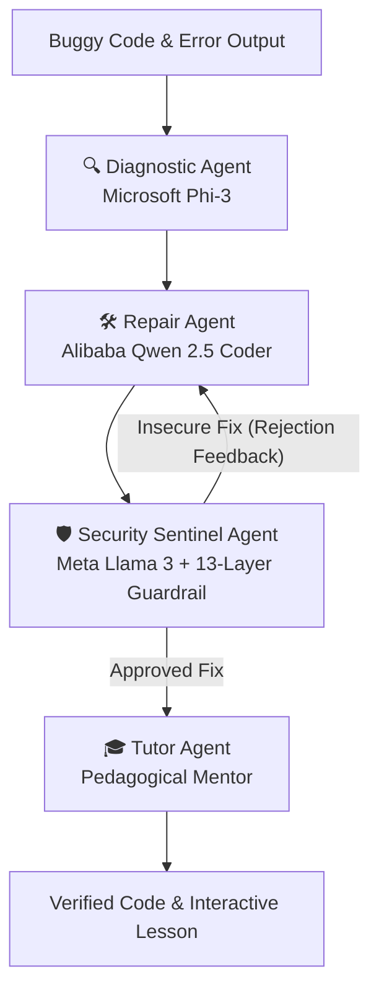

# Collaborative Multi-Agent Compiler & Debugger Platform
An Automated Program Repair (APR) and programming education platform that securely diagnoses, repairs, and teaches code errors using a collaborative Multi-Agent team powered by **Microsoft Phi-3**, **Alibaba Qwen**, and **Meta Llama 3** models.

---

## 🌟 Key Capabilities
* **Multi-Model Support:** Native integration with **Microsoft Phi-3** (`phi3:mini`, `phi3:medium`), **Alibaba Qwen** (`qwen2.5:coder`, `qwen2.5-coder:1.5b`, `qwen2.5:latest`), and **Meta Llama** (`llama3.2:1b`, `llama3:latest`).
* **Collaborative Multi-Agent Architecture:** Four specialized agents collaborating in a supervised pipeline with automated security rejection and iterative repair loops.
* **Multi-Model Council (Consensus Mode):** Solves bugs simultaneously with Llama 3, Phi-3, and Qwen, compares patches side-by-side, and selects the optimal security-audited fix.
* **Multi-Language Sandbox:** Secure sandboxed compilation and execution across **C++**, **Python**, and **Java**.
* **13-Layer Defense-in-Depth:** Input validation, static security AST guardrails, memory protection, non-root isolated Docker containers, cgroup caps, output sanitization, and AI fix verification.

---

## 👥 Multi-Agent Platform Roles



1. **🔍 Diagnostic Agent (Error Detective):**
   - *Default Model:* `phi3:mini` (Microsoft 3.8B Logic Engine)
   - *Role:* Pinpoints line numbers, syntax mechanisms, memory faults, and underlying failure modes.
2. **🛠️ Repair Agent (Code Architect):**
   - *Default Model:* `qwen2.5:coder` (Alibaba State-of-the-Art Coding LLM)
   - *Role:* Synthesizes minimal, idiomatic, compile-ready patches preserving original variable names and intent.
3. **🛡️ Security Sentinel Agent (Auditor):**
   - *Default Model:* `llama3.2:1b` + 13-Layer Security Pipeline
   - *Role:* Intercepts OWASP/CWE violations (buffer overflows, command injections, format strings, unsafe pointers). If unsafe, triggers iterative re-synthesis back to the Repair Agent.
4. **🎓 Tutor Agent (Pedagogical Mentor):**
   - *Default Model:* `phi3:mini` / `llama3:latest`
   - *Role:* Delivers structured lessons: "Why did this happen?", core invariant rules, and algorithmic complexity (Big-O).
5. **🌐 MultiAgent Orchestrator:**
   - Coordinates message passing, consensus evaluation, and specialized model routing.

---

## 🤖 Supported Models & Pull Commands

Ensure [Ollama](https://ollama.ai) is installed and running:

```bash
# 1. Start Ollama
ollama serve

# 2. Pull Microsoft Phi-3
ollama pull phi3:mini
ollama pull phi3:medium

# 3. Pull Alibaba Qwen 2.5 Coder
ollama pull qwen2.5:coder
ollama pull qwen2.5-coder:1.5b

# 4. Pull Meta Llama 3
ollama pull llama3.2:1b
ollama pull llama3
```

---

## 🚀 Platform Modes in Web UI

1. **🤖 Multi-Agent Swarm:** The full 4-agent team runs sequentially. Displays interactive tabs for Detective findings, Architect code, Sentinel security verdict, and Mentor lessons.
2. **🏛️ Multi-Model Council:** Simultaneously queries Meta Llama 3, Microsoft Phi-3, and Alibaba Qwen. Displays side-by-side comparison tabs with individual security audits.
3. **⚡ Single-Model Direct Mode:** Fast direct inference with any chosen model.

---

## 🔒 13-Layer Defense-in-Depth Pipeline

1. `input_validator.py` -> **Layer 1 (Input Validation):** Malformed/oversized code, null-byte injection, binary/control characters.
2. `security_scanner.py` -> **Layer 2 (Static Security Scanner) & Layer 12 (AI Fix Verification):** Blocks dangerous functions (`system`, `popen`, `gets`, `strcpy`, format strings) and validates LLM repair suggestions.
3. `Dockerfile` -> **Layer 3 (Docker Isolation), Layer 6 (Read-Only FS), Layer 7 (Non-Root Execution UID 1000):** Minimal Alpine-based build.
4. `docker_executor.py` -> **Layer 3, 4, 8 (Docker Executor):** Enforces `--network none`, `--cap-drop ALL`, isolated container runner.
5. `resource_controller.py` -> **Layer 5 (Resource Limits) & Layer 9 (Process/PID Limits):** 256MB RAM, 1.0 CPU, max 32 PIDs.
6. `output_controller.py` -> **Layer 10 (Output Limits):** Caps stdout/stderr to 50KB / 1000 lines & strips ANSI bombs.
7. `timeout_controller.py` -> **Layer 11 (Execution Timeout):** Hard execution kill switches (5s run, 12s compile).
8. `security_logger.py` -> **Layer 13 (Audit & Security Logging):** Real-time incident logging to `security_events.csv` and `system_interactions.json`.

---

## 🧪 Testing & Verification

1. Change directory:
   ```bash
   cd Chatbot-Driven-Compiler-Debugger
   ```
2. Run the Multi-Agent Platform test suite:
   ```bash
   python tests/test_multiagent_platform.py
   ```
3. Run the complete 13-layer security test suite:
   ```bash
   python test_all_security_layers.py
   ```
4. Start the interactive Streamlit Web UI:
   ```bash
   streamlit run app.py
   ```
